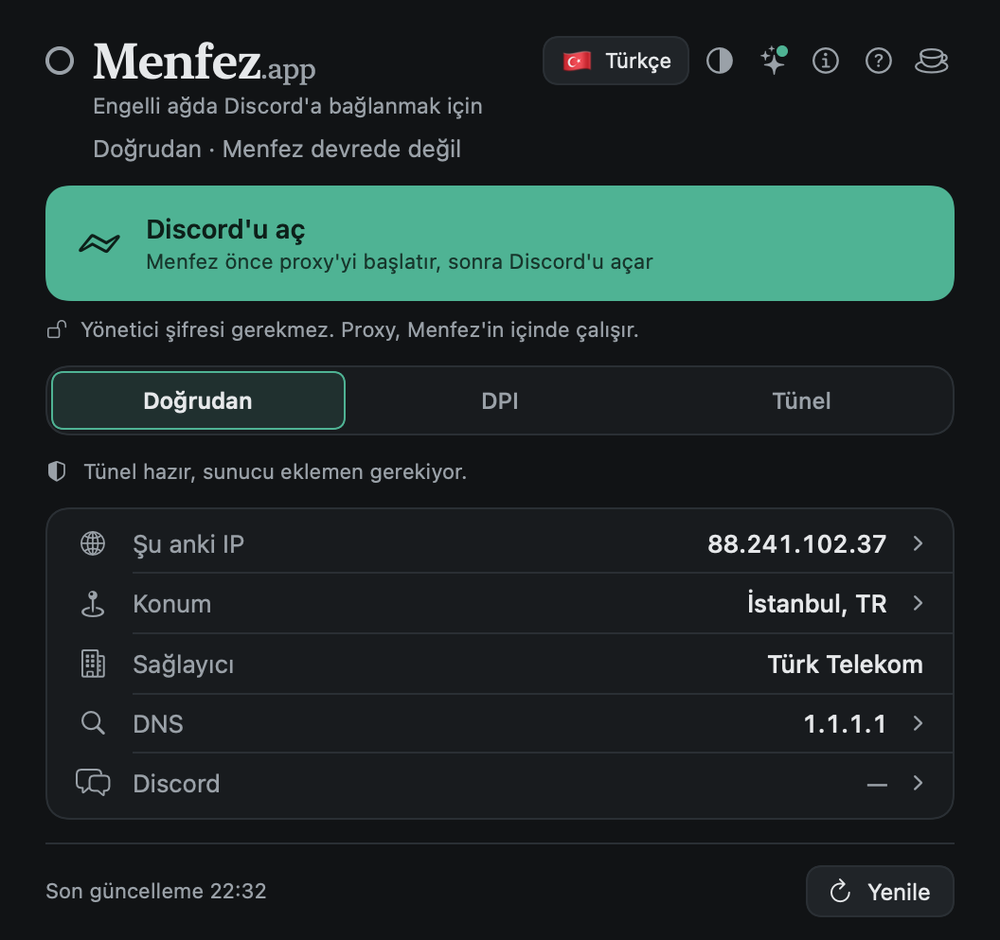
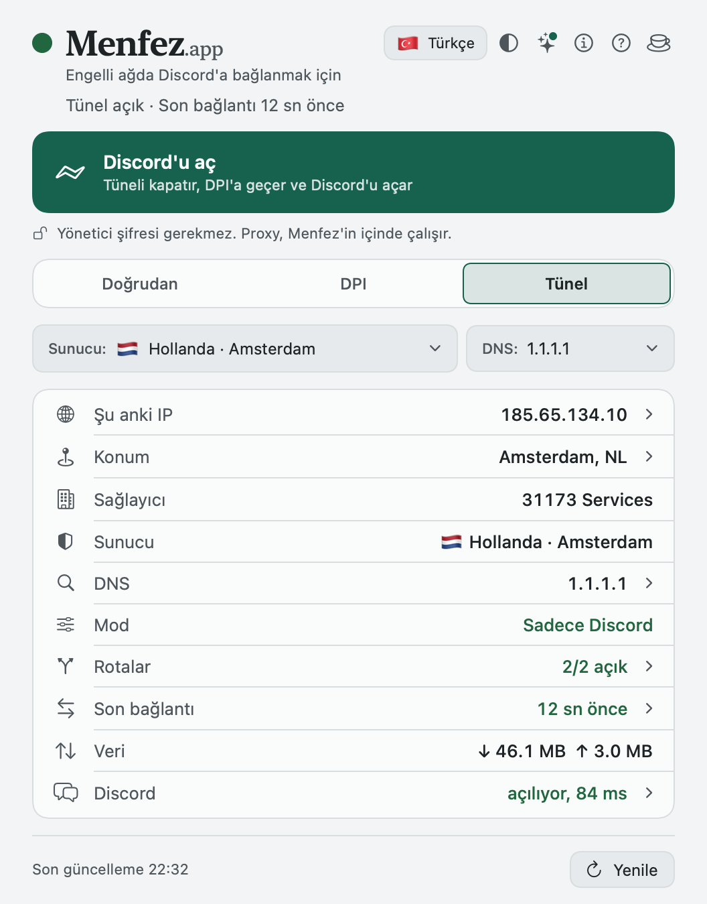
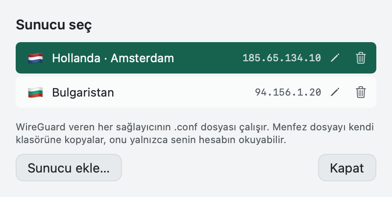

<p align="center">
  
</p>

<h1 align="center">Menfez</h1>

<p align="center">
  Engelli ağda Discord'a bağlanmak için macOS uygulaması<br>
  Open Discord on networks that block it (macOS)
</p>

<p align="center">
  <a href="#türkçe">Türkçe</a> · <a href="#english">English</a> ·
  <a href="https://github.com/BurhanRB/Menfez/releases">İndir / Download</a>
</p>

<p align="center">
  
  
</p>

<table>
  <tr>
    <td align="center"><br>DPI</td>
    <td align="center"><br>Tünel / Tunnel</td>
    <td align="center"><br>Yardım / Help</td>
  </tr>
  <tr>
    <td align="center"><br>Sunucular / Servers</td>
    <td align="center"><br>Yenilikler / What's new</td>
    <td align="center"><br>Menü çubuğu / Menu bar</td>
  </tr>
</table>

---

## Türkçe

### Menfez nedir

Menfez, Discord'un engellendiği ağlarda Discord'a bağlanmanı sağlayan bir macOS
uygulamasıdır. DPI modu bilgisayarının içinde küçük bir proxy çalıştırır ve
yönetici şifresi istemez. İstersen kendi WireGuard sunucunu ekleyip trafiği
onun üzerinden de geçirebilirsin. Menfez'in bir sunucusu yoktur; tünel için
kendi sunucunu ya da kullandığın VPN sağlayıcısının WireGuard dosyasını getirirsin.

macOS 13 (Ventura) ve sonrası, Apple silicon ve Intel.

### Kurulum

1. [Releases](https://github.com/BurhanRB/Menfez/releases) sayfasından Mac'ine uygun dosyayı indir:
   - Apple Silicon (M1, M2, M3, M4 …): `Menfez-<sürüm>-arm64.dmg`
   - Intel: `Menfez-<sürüm>-intel.dmg`

   Hangisi olduğunu bilmiyorsan: sol üstteki Apple menüsü > **Bu Mac Hakkında**.
   "Çip: Apple M…" yazıyorsa arm64, "İşlemci: Intel" yazıyorsa intel.
2. DMG'yi aç, Menfez'i **Uygulamalar** klasörüne sürükle.
3. İlk açılışta Uygulamalar klasöründe Menfez'e **sağ tıkla > Aç**, çıkan pencerede yine **Aç**'a bas.
   Bu sadece ilk seferde gerekir, çünkü bu sürüm henüz Apple tarafından imzalanmadı.

Homebrew kullanıyorsan tek satır yeter:

```sh
brew tap burhanrb/menfez
brew trust burhanrb/menfez   # Homebrew 7 ve sonrası başka depolara bu onayı ister
brew install --cask menfez
```

**Açılmazsa:** Menfez'i bir kere açmayı dene, **Bitti**'ye bas. Sonra **Sistem
Ayarları > Gizlilik ve Güvenlik**'i aç, aşağı kaydır ve **Yine de Aç**'a bas.
macOS "Menfez hasarlı" derse dosya bozuk değildir, macOS sadece ona güvenmiyordur.
Terminal'de şunu çalıştırıp Menfez'i yeniden aç:

```sh
xattr -dr com.apple.quarantine /Applications/Menfez.app
```

İndirdiğin dosyayı `SHA256SUMS` ile karşılaştırmak istersen: `shasum -a 256 Menfez-*.dmg`.

### Modlar

- **Doğrudan:** Menfez devrede değil. Ağın nasıl çalışıyorsa öyle.
- **DPI:** Menfez bilgisayarında bir proxy başlatır ve Discord'u bu proxy ile
  açar. Proxy, bağlantının ilk mesajını iki parçaya böler; içerik aynı kalır ama
  engelleyen cihaz Discord'un adını göremez. Yönetici şifresi gerekmez. Discord'u
  Menfez'in açması gerekir, o yüzden önce Discord'u kapat.
- **Tünel:** İsteğe bağlı. Trafiği kendi WireGuard sunucun üzerinden geçirir.
  Sadece Discord'u ya da tüm trafiği tünele yollamayı seçebilirsin. Bir kerelik
  kurulum ister (aşağıda).

### Kendi WireGuard dosyanı eklemek

WireGuard konuşan her sağlayıcının ya da kendi sunucunun `.conf` dosyası olur.
Menfez'de sunucu menüsünden **Sunucu ekle…** ile seç ya da dosyayı şu klasöre koy:

```
~/Library/Application Support/Menfez/wireguard/
```

Menfez hiçbir sağlayıcının hesabına bağlanmaz, dosyandaki anahtarı kimseye göndermez.

### Tünel kurulumu

Tünel modu için WireGuard araçları ve bir kerelik yönetici kurulumu gerekir:

```sh
brew install wireguard-tools wireguard-go bash
sudo /bin/bash /Applications/Menfez.app/Contents/Resources/install-helper.sh \
  /Applications/Menfez.app/Contents/MacOS/menfez-route "$USER"
```

Aynı komut uygulamanın Yardım panelinde de yazar. Bu komut:

- Tünel yardımcısını (`menfez-route`) ve WireGuard araçlarının kopyalarını
  `/Library/PrivilegedHelperTools/menfez/` içine koyar. Bu klasörü sadece root değiştirebilir.
- `/etc/sudoers.d/menfez` içine tek bir kural yazar: senin kullanıcın sadece bu
  yardımcıyı şifresiz `sudo` ile çalıştırabilir. Başka hiçbir komuta izin vermez.
- Kuralı `visudo -c` ile denetler; hatalıysa geri siler.

Menfez'i ya da WireGuard'ı güncelledikten sonra bu komutu bir kez daha çalıştır.

### Gizlilik

- Geliştiriciye hiçbir şey gönderilmez. Hesap, analiz ya da telemetri yok.
- **IP ve konum:** Ekrandaki IP adresi `api.ipify.org`'dan, konum ve sağlayıcı
  `ipinfo.io`'dan alınır.
- **DNS:** DPI modunda alan adları seçtiğin DoH sağlayıcısına (Cloudflare,
  Google, Quad9 ya da AdGuard) sorulur.
- **Tünel:** Trafiğin senin seçtiğin WireGuard sunucusuna gider.
- **Hata kaydı:** Sadece sen kaydedersen oluşur ve bilgisayarında kalır. IP
  adreslerin ve anahtarların içinde gizlenir.

### Kaldırma

Homebrew ile kurduysan:

```sh
brew uninstall --cask menfez        # uygulamayı, tünel yardımcısını ve sudo kuralını kaldırır
brew uninstall --zap --cask menfez  # profillerini ve ayarlarını da siler
```

Elle kurduysan bu depodaki betiği çalıştır:

```sh
./uninstall.sh              # her şeyi kaldırır
./uninstall.sh --keep-data  # profilleri ve ayarları bırakır
./uninstall.sh --dry-run    # neyin silineceğini gösterir
```

### Lisans

Apache-2.0. Bkz. [LICENSE](LICENSE).


### Geliştiriciler için

#### Kaynaktan derleme

Xcode gerekir (SwiftUI makro eklentisi Command Line Tools'ta yok).

```sh
export DEVELOPER_DIR=/Applications/Xcode.app/Contents/Developer
(cd Menfez && swift test)   # testler
./build-app.sh              # Menfez.app, universal (arm64 + x86_64), ad-hoc imzalı
./build-dmg.sh              # Menfez-<sürüm>-arm64.dmg ve Menfez-<sürüm>-intel.dmg
./install.sh                # /Applications'a kurar (--tunnel ile tünel kurulumu da)
```

#### Sürüm kuralı

Her sürümde `build-app.sh` içindeki `VERSION`'ın son hanesi bir artar
(1.0.0, 1.0.1, 1.0.2 …) ve `Menfez/Sources/MenfezCore/Changelog.swift`'in en
üstüne yeni bir kayıt eklenir. İkisi uyuşmazsa `ChangelogTests` başarısız olur.

---

## English

### What Menfez is

Menfez is a macOS app that lets you open Discord on networks that block it. DPI
mode runs a small proxy inside the app on your Mac and needs no administrator
password. If you want, you can add your own WireGuard server and send traffic
through it instead. Menfez ships no server; for the tunnel you bring your own
server or your VPN provider's WireGuard file.

macOS 13 (Ventura) or later, Apple silicon and Intel.

### Install

1. Download the file for your Mac from [Releases](https://github.com/BurhanRB/Menfez/releases):
   - Apple Silicon (M1, M2, M3, M4 …): `Menfez-<version>-arm64.dmg`
   - Intel: `Menfez-<version>-intel.dmg`

   Not sure which? Apple menu (top left) > **About This Mac**. "Chip: Apple M…"
   means arm64, "Processor: Intel" means intel.
2. Open the DMG and drag Menfez into **Applications**.
3. The first time, in Applications **right-click Menfez > Open**, then click **Open** again.
   You only need this once, because this build is not signed by Apple yet.

If you use Homebrew, one line does it:

```sh
brew tap burhanrb/menfez
brew trust burhanrb/menfez   # Homebrew 7 and later asks you to trust third-party taps
brew install --cask menfez
```

**If it still will not open:** try to open Menfez once and click **Done**. Then
open **System Settings > Privacy & Security**, scroll down and click **Open
Anyway**. If macOS says "Menfez is damaged", the file is fine; macOS just does
not trust it. Run this in Terminal and open Menfez again:

```sh
xattr -dr com.apple.quarantine /Applications/Menfez.app
```

To check the download against `SHA256SUMS`: `shasum -a 256 Menfez-*.dmg`.

### Modes

- **Direct:** Menfez is off. Your network works as it normally does.
- **DPI:** Menfez starts a proxy on your Mac and opens Discord through it. The
  proxy splits the first message of each connection in two; the content is the
  same, but the blocking device cannot read Discord's name. No administrator
  password. Menfez has to be the one that opens Discord, so quit Discord first.
- **Tunnel:** Optional. Sends traffic through your own WireGuard server. You can
  send only Discord or all traffic through it. Needs a one-time setup (below).

### Adding your own WireGuard file

Any WireGuard provider, or your own server, gives you a `.conf` file. In Menfez
use **Add server…** in the server menu, or put the file in:

```
~/Library/Application Support/Menfez/wireguard/
```

Menfez does not log in to any provider and does not send your key anywhere.

### Tunnel setup

Tunnel mode needs the WireGuard tools and a one-time admin setup:

```sh
brew install wireguard-tools wireguard-go bash
sudo /bin/bash /Applications/Menfez.app/Contents/Resources/install-helper.sh \
  /Applications/Menfez.app/Contents/MacOS/menfez-route "$USER"
```

The app's Help panel shows the same command. It:

- Copies the tunnel helper (`menfez-route`) and copies of the WireGuard tools
  into `/Library/PrivilegedHelperTools/menfez/`, which only root can change.
- Writes one rule to `/etc/sudoers.d/menfez`: your user may run that one helper
  with `sudo` without a password. Nothing else.
- Checks the rule with `visudo -c` and removes it again if it is invalid.

Run the command again after updating Menfez or WireGuard.

### Privacy

- Nothing is sent to the author. No account, no analytics, no telemetry.
- **IP and location:** the IP address on screen comes from `api.ipify.org`;
  location and provider come from `ipinfo.io`.
- **DNS:** in DPI mode, names are looked up with the DoH provider you pick
  (Cloudflare, Google, Quad9 or AdGuard).
- **Tunnel:** your traffic goes to the WireGuard server you chose.
- **Debug log:** only created when you save it, and it stays on your Mac. IP
  addresses and keys are hidden in it.

### Uninstall

If you installed with Homebrew:

```sh
brew uninstall --cask menfez        # removes the app, the tunnel helper and the sudo rule
brew uninstall --zap --cask menfez  # also deletes your profiles and settings
```

If you installed by hand, run the script from this repository:

```sh
./uninstall.sh              # remove everything
./uninstall.sh --keep-data  # keep profiles and settings
./uninstall.sh --dry-run    # show what would be removed
```

### License

Apache-2.0. See [LICENSE](LICENSE).

### For developers

#### Build from source

Needs Xcode (the SwiftUI macro plugin is not in the Command Line Tools).

```sh
export DEVELOPER_DIR=/Applications/Xcode.app/Contents/Developer
(cd Menfez && swift test)   # tests
./build-app.sh              # Menfez.app, universal (arm64 + x86_64), ad-hoc signed
./build-dmg.sh              # Menfez-<version>-arm64.dmg and Menfez-<version>-intel.dmg
./install.sh                # installs to /Applications (--tunnel also runs the tunnel setup)
```

More detail: [docs/DPI-ENGINE.md](docs/DPI-ENGINE.md),
[docs/READ-PATH.md](docs/READ-PATH.md), [docs/SIGNING.md](docs/SIGNING.md),
[docs/ICON.md](docs/ICON.md).

#### Release rule

Every release bumps the last number of `VERSION` in `build-app.sh` (1.0.0,
1.0.1, 1.0.2 …) and adds an entry at the top of
`Menfez/Sources/MenfezCore/Changelog.swift`. `ChangelogTests` fails if the two
disagree.
