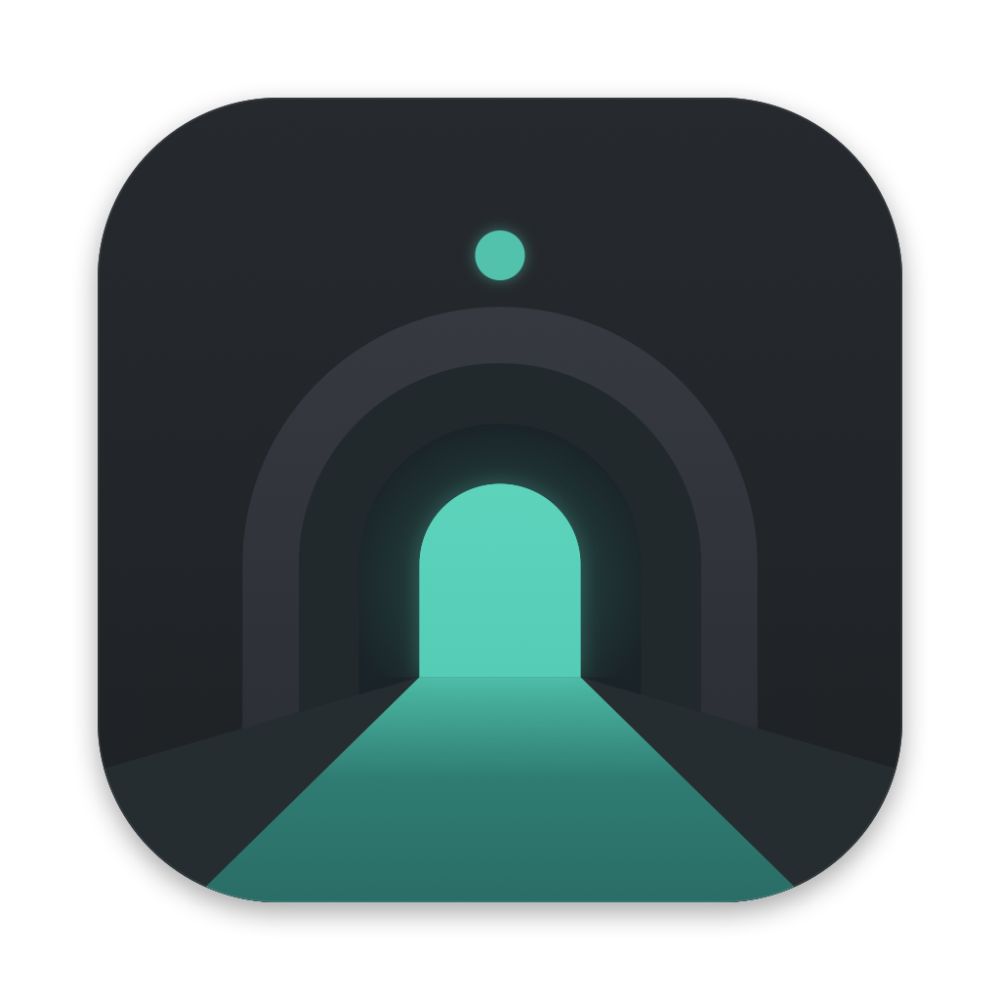
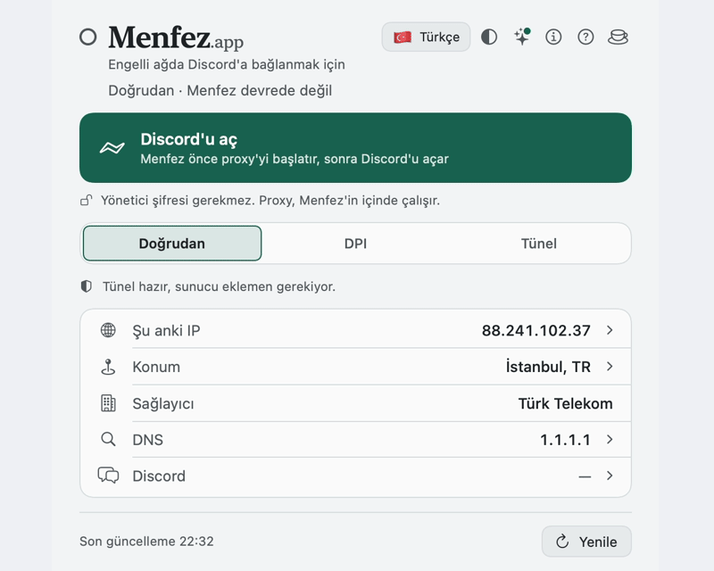
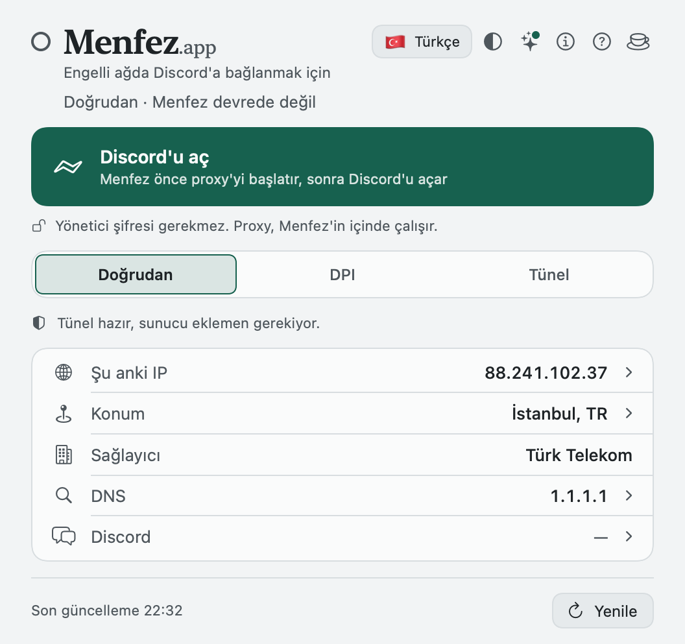
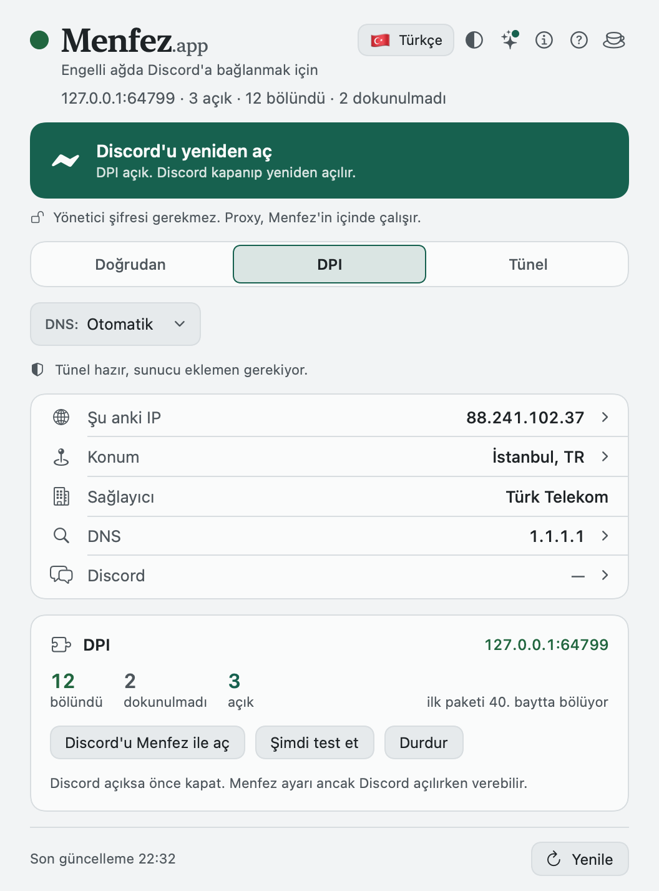
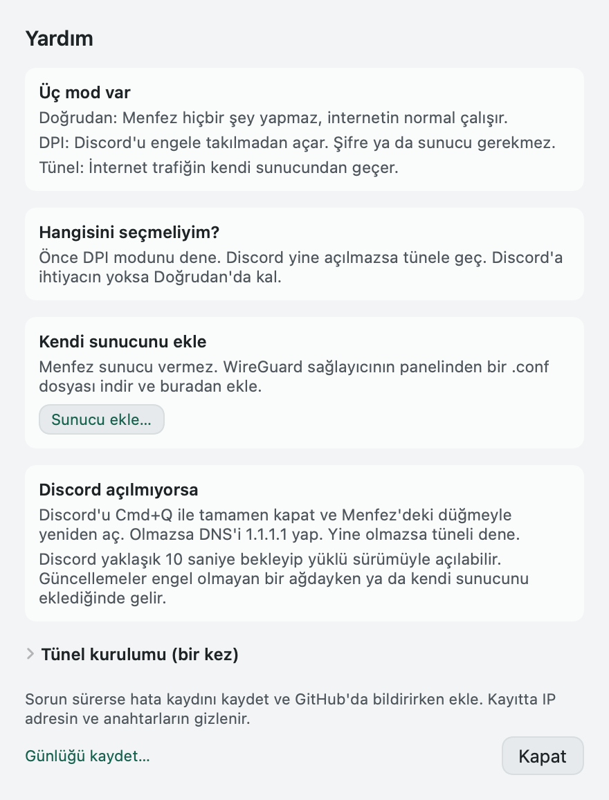
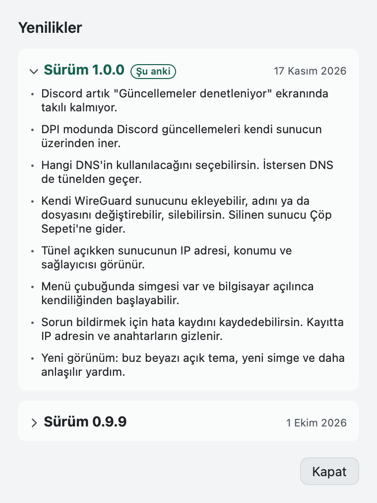

<p align="center">
  
</p>

<h1 align="center">Menfez<sub><sup>.app</sup></sub></h1>

<p align="center">
  Engelli ağda Discord'a bağlanmak için macOS uygulaması<br>
  Open Discord on networks that block it (macOS)
</p>

<p align="center">
  <a href="https://github.com/BurhanRB/Menfez/releases"></a>
  
  
  <a href="LICENSE"></a>
  <a href="https://github.com/BurhanRB/Menfez/releases"></a>
</p>

<h3 align="center"><a href="https://github.com/BurhanRB/Menfez/releases">İndir / Download</a></h3>

<p align="center">
  
</p>

<details open>
<summary><b>🇹🇷 Türkçe</b></summary>

### Nedir

Menfez, Discord'un engellendiği ağlarda Discord'a bağlanmanı sağlayan bir macOS
uygulamasıdır. DPI modu bilgisayarının içinde küçük bir proxy çalıştırır ve
yönetici şifresi istemez. macOS 13 (Ventura) ve sonrası, Apple silicon ve Intel.

### Kurulum

1. [Releases](https://github.com/BurhanRB/Menfez/releases) sayfasından indir:
   Apple Silicon (M1, M2 …) için `Menfez-<sürüm>-arm64.dmg`, Intel için `Menfez-<sürüm>-intel.dmg`.
   Emin değilsen: Apple menüsü > **Bu Mac Hakkında**.
2. DMG'yi aç, Menfez'i **Uygulamalar** klasörüne sürükle.
3. Menfez'i aç.

Homebrew ile:

```sh
brew tap burhanrb/menfez
brew trust burhanrb/menfez
brew install --cask menfez
```

**İlk açılış:** Bu sürüm Apple tarafından imzalı değil. Menfez'e **sağ tıkla > Aç**
ya da **Sistem Ayarları > Gizlilik ve Güvenlik > Yine de Aç**.

### Modlar

- **Doğrudan:** Menfez devrede değil, ağın olduğu gibi çalışır.
- **DPI:** Discord'u yerel bir proxy ile açar; bağlantının ilk mesajını bölerek engelleyen cihazdan Discord'un adını gizler. Önce Discord'u kapat.
- **Tünel:** İsteğe bağlı. Discord'u ya da tüm trafiği kendi WireGuard sunucun üzerinden geçirir.
  Bir kerelik kurulum: `brew install wireguard-tools wireguard-go bash`, sonra uygulamada **Tüneli kur**'a bas (macOS yönetici şifreni sorar).

### Kendi WireGuard sunucun

Menfez'in bir sunucusu yoktur. Kendi sunucunun ya da VPN sağlayıcının `.conf`
dosyasını **Sunucu ekle…** ile ekle ya da `~/Library/Application Support/Menfez/wireguard/` içine koy.

### Gizlilik

- Hesap, analiz ya da telemetri yok; geliştiriciye hiçbir şey gönderilmez.
- Mac'ten çıkanlar: IP için `api.ipify.org`, konum için `ipinfo.io`, DPI modunda seçtiğin DoH sağlayıcısı (Cloudflare, Google, Quad9, AdGuard), tünelde senin WireGuard sunucun.
- Hata kaydı sadece sen kaydedersen oluşur, Mac'inde kalır; IP ve anahtarlar gizlenir.

<details>
<summary>Daha fazla</summary>

#### Tünel kurulumu

Normalde uygulamadaki **Tüneli kur** düğmesi bunu yapar. Elle yapmak istersen (Menfez ya da WireGuard güncellenince tekrar çalıştır):

```sh
brew install wireguard-tools wireguard-go bash
sudo /bin/bash /Applications/Menfez.app/Contents/Resources/install-helper.sh \
  /Applications/Menfez.app/Contents/MacOS/menfez-route "$USER"
```

Yardımcıyı `/Library/PrivilegedHelperTools/menfez/` içine koyar ve `/etc/sudoers.d/menfez`
içine tek kural yazar: kullanıcın sadece bu yardımcıyı şifresiz `sudo` ile çalıştırabilir.
Kural `visudo -c` ile denetlenir, hatalıysa silinir.

#### Kaldırma

- Homebrew: `brew uninstall --cask menfez` (ayarları da silmek için `--zap` ekle)
- Elle: bu depodaki `./uninstall.sh` (`--keep-data` ayarları bırakır, `--dry-run` sadece gösterir)

#### Sorun giderme

- "Menfez hasarlı" diyorsa dosya bozuk değil: `xattr -dr com.apple.quarantine /Applications/Menfez.app`
- İndirmeyi doğrulamak için: `shasum -a 256 Menfez-*.dmg` ve `SHA256SUMS` ile karşılaştır.
- DPI çalışmıyorsa Discord'u tamamen kapatıp Menfez'den aç.

</details>
</details>

<details>
<summary><b>🇬🇧 English</b></summary>

### What it is

Menfez is a macOS app that lets you open Discord on networks that block it. DPI
mode runs a small proxy on your Mac and needs no administrator password.
macOS 13 (Ventura) or later, Apple silicon and Intel.

### Install

1. Download from [Releases](https://github.com/BurhanRB/Menfez/releases):
   `Menfez-<version>-arm64.dmg` for Apple Silicon (M1, M2 …), `Menfez-<version>-intel.dmg` for Intel.
   Not sure? Apple menu > **About This Mac**.
2. Open the DMG and drag Menfez into **Applications**.
3. Open Menfez.

With Homebrew:

```sh
brew tap burhanrb/menfez
brew trust burhanrb/menfez
brew install --cask menfez
```

**First open:** this build is not signed by Apple. **Right-click Menfez > Open**,
or **System Settings > Privacy & Security > Open Anyway**.

### Modes

- **Direct:** Menfez is off; your network works as usual.
- **DPI:** opens Discord through a local proxy that splits the first message of each connection, so the blocking device cannot read Discord's name. Quit Discord first.
- **Tunnel:** optional. Sends Discord, or all traffic, through your own WireGuard server.
  One-time setup: `brew install wireguard-tools wireguard-go bash`, then press **Set up tunnel** in the app (macOS asks for your administrator password).

### Your own WireGuard server

Menfez ships no server. Add your own server's or your VPN provider's `.conf` file
with **Add server…**, or put it in `~/Library/Application Support/Menfez/wireguard/`.

### Privacy

- No account, no analytics, no telemetry; nothing is sent to the author.
- What leaves your Mac: `api.ipify.org` for the IP, `ipinfo.io` for location, the DoH provider you pick in DPI mode (Cloudflare, Google, Quad9, AdGuard), and your WireGuard server in tunnel mode.
- The debug log exists only if you save it, stays on your Mac, and hides IPs and keys.

<details>
<summary>More</summary>

#### Tunnel setup

The app's **Set up tunnel** button does this for you. To do it by hand instead (run again after updating Menfez or WireGuard):

```sh
brew install wireguard-tools wireguard-go bash
sudo /bin/bash /Applications/Menfez.app/Contents/Resources/install-helper.sh \
  /Applications/Menfez.app/Contents/MacOS/menfez-route "$USER"
```

It puts the helper in `/Library/PrivilegedHelperTools/menfez/` and writes one rule to
`/etc/sudoers.d/menfez`: your user may run that one helper with `sudo` without a password.
The rule is checked with `visudo -c` and removed if invalid.

#### Uninstall

- Homebrew: `brew uninstall --cask menfez` (add `--zap` to delete settings too)
- By hand: `./uninstall.sh` from this repo (`--keep-data` keeps settings, `--dry-run` only shows)

#### Troubleshooting

- "Menfez is damaged" means macOS does not trust it, not that it is broken: `xattr -dr com.apple.quarantine /Applications/Menfez.app`
- To verify a download: `shasum -a 256 Menfez-*.dmg` and compare with `SHA256SUMS`.
- If DPI does not work, quit Discord fully and open it from Menfez.

</details>
</details>

<table>
  <tr>
    <td align="center"><br>Açık / Light</td>
    <td align="center"><br>DPI</td>
    <td align="center"><br>Tünel / Tunnel</td>
  </tr>
  <tr>
    <td align="center"><br>Sunucular / Servers</td>
    <td align="center"><br>Yardım / Help</td>
    <td align="center"><br>Yenilikler / What's new</td>
  </tr>
</table>

<details>
<summary><b>Geliştiriciler için / For developers</b></summary>

Xcode gerekir / Needs Xcode (the SwiftUI macro plugin is not in the Command Line Tools).

```sh
export DEVELOPER_DIR=/Applications/Xcode.app/Contents/Developer
(cd Menfez && swift test)   # tests
./build-app.sh              # Menfez.app, universal (arm64 + x86_64), ad-hoc signed
./build-dmg.sh              # Menfez-<version>-arm64.dmg, Menfez-<version>-intel.dmg
./install.sh                # installs to /Applications (--tunnel also runs the tunnel setup)
```

**Sürüm kuralı / Release rule:** every release bumps the last number of `VERSION` in
`build-app.sh` (1.0.0, 1.0.1 …) and adds an entry at the top of
`Menfez/Sources/MenfezCore/Changelog.swift`. `ChangelogTests` fails if they disagree.

More: [DPI-ENGINE](docs/DPI-ENGINE.md) · [READ-PATH](docs/READ-PATH.md) · [SIGNING](docs/SIGNING.md) · [ICON](docs/ICON.md)

</details>

Apache-2.0, bkz. / see [LICENSE](LICENSE). Discord is a trademark of Discord Inc.; Menfez is not affiliated with it.
